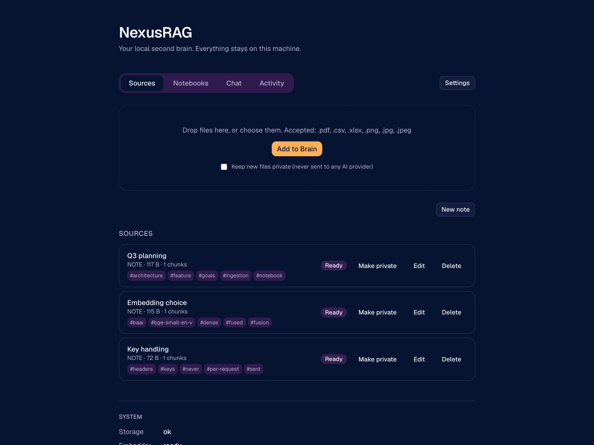
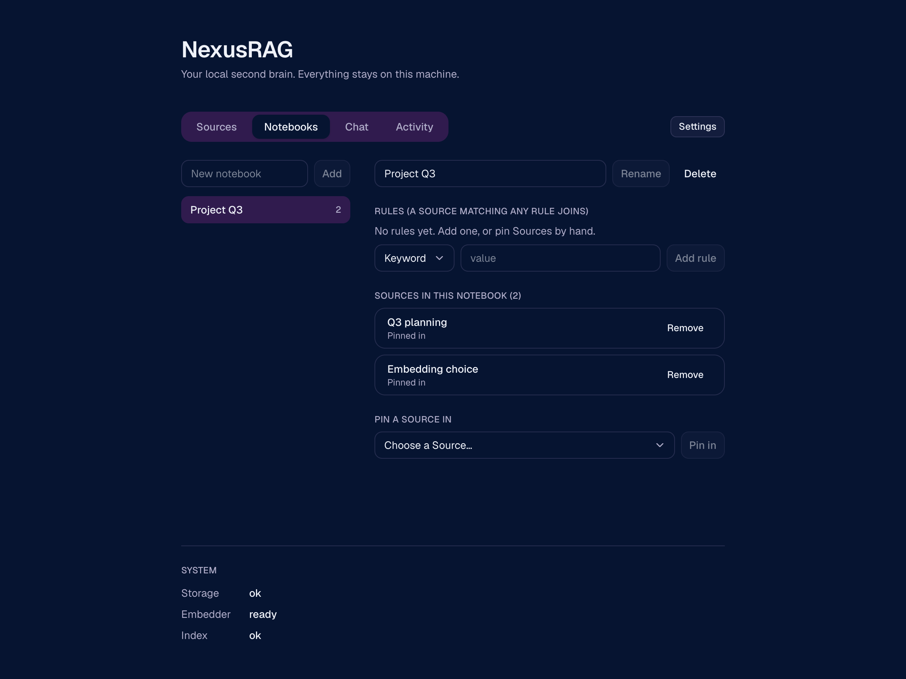
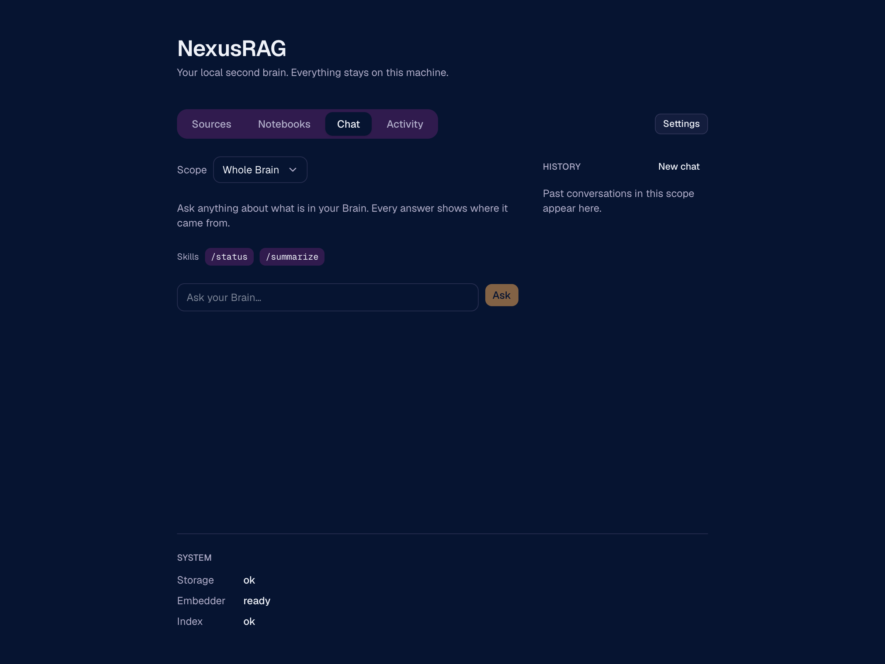
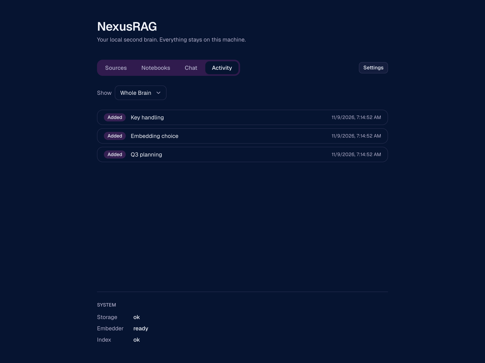

# NexusRAG

Local-first second brain. Collect PDFs, images, spreadsheets and Markdown notes in one place, organise them into notebooks, and chat with them through your own AI provider (bring your own key). Everything runs on your machine.

Status: v1 built. Everything under "Highlights" works; the roadmap below is what comes next.

## Highlights

- Files become text once, then indexed locally with dense and BM25 vectors that fused through reciprocal rank fusion. The answers pass a calibrated relevance gate before any model sees them.
- Text-grounded hybrid RAG: every file is turned into text once at ingestion (extraction, local OCR, optional vision caption), then retrieved with one local text embedder plus keyword search, so answers about charts and tables cite real text.
- Offline, hash-cached ingestion: re-uploading a file never repeats extraction, OCR or captioning.
- Stateless BYOK: your API key stays in your browser and is sent per request; the server never stores or logs it.
- Notebooks fill themselves from rules and accept manual pins; private sources never reach any AI provider.
- Chat skills such as `/summarize` and `/status`.

## Screenshots

| Sources | Notebooks |
| --- | --- |
|  |  |
| **Chat** | **Activity** |
|  |  |

## Stack

- `api/`: Python, uv, FastAPI, Qdrant (embedded), SQLite
- `web/`: Next.js, bun, Tailwind, shadcn/ui
- `skills/`: one Markdown file per skill

## Providers

Anthropic, OpenAI, and any OpenAI-compatible endpoint (Ollama, OpenRouter, OpenCode).

## Run it

```bash
# API (binds to 127.0.0.1 only)
cd api && uv sync && uv run python -m nexusrag

# Web (http://localhost:3000)
cd web && bun install && bun run dev
```

Tests: `cd api && uv run pytest`, `cd web && bun test`, and `cd web && bun run e2e` for the browser smoke test.
Data lives in one local `data/` folder. Add your own skill by dropping a Markdown file into `skills/`.

## Roadmap

Ideas for later. None of these are in v1.

**More sources**
- Web links, YouTube, PowerPoint and audio (with transcription).
- Import a Markdown or Obsidian vault. Other Note formats beyond Markdown.
- A stronger local OCR as a second Extractor: [`baidu/Unlimited-OCR`](https://github.com/baidu/Unlimited-OCR) (MIT, reads long documents in one pass). Its README only supports CUDA today, so revisit once there is an Apple Silicon path or a CUDA machine to run it on.
- A durable ingestion queue with retries and backoff, instead of the in-process runner.

**Smarter organisation and retrieval**
- LLM topic classification for Notebook Rules, strictly opt-in so ingestion never depends on a key.
- Semantic Rules: a Notebook admits Sources close in meaning to its description.
- Auto-suggested Tags that you can confirm or edit.
- Multilingual embeddings (for example Indonesian). This means re-embedding the whole Brain; the extraction cache keeps that cheap.
- A reranker and a larger k, only if the eval shows a need. A bigger eval set built from real documents.

**Features inspired by NotebookLM and Open Notebook**
- Podcast generator: turn Notes and Sources into spoken episodes with customisable voices.
- Automatic summaries on ingest.
- Note version history, and a Trash with restore instead of hard delete.
- More built-in Skills, and a way to share your own.

**Platform**
- Mobile-friendly UI.
- Beyond a single machine: accounts, multi-user, LAN or remote access, hosted deployment. Out of scope for now. If it ever happens, tenant isolation at the database layer is the plan.
- Not planned, on purpose: any server-side storage of API keys.
